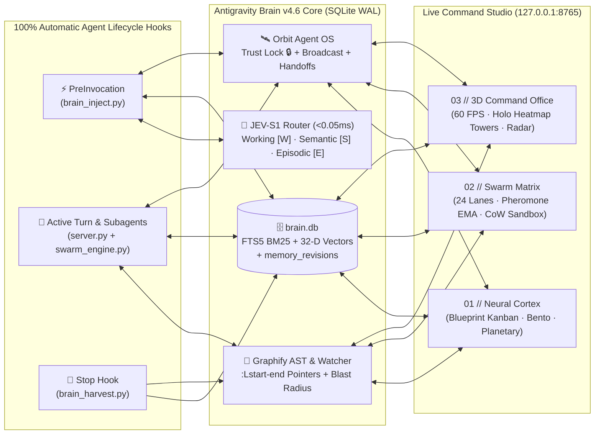

<div align="center">

# 🧠 Antigravity Brain v4.8

**Zero-Round-Trip Persistent Memory Engine, Recursive Self-Learning & Proactive Sentinel, DOTS 3-Layer Stack, Orbit Agent OS & 60 FPS 3D Command Studio for AI Coding Agents**

[](https://github.com/Miguel-Reis/antigravity-brain/releases)
[-38bdf8?style=for-the-badge&logo=python&logoColor=white)](https://www.python.org/)
[](./db_engine.py)
[](./orbit_engine.py)
[](./orbit_engine.py)
[](./test_brain.py)

*Built with 100% Python Standard Library (`sqlite3`, `ast`, `http.server`, `threading`) and Vanilla HTML5/Canvas2D/WebAudio — zero `pip` packages required, zero cloud telemetry, sub-10ms local execution.*

[Quick Install](#-quick-install) • [Architecture](#-how-it-works-zero-round-trip-memory-protocol) • [Token Diet (-95%)](#-5-stage-token-diet--context-pipeline) • [Orbit Agent OS](#️-orbit-agent-os-mission-control) • [3D Dashboard](#️-command-studio-dashboard-http1270018765) • [MCP Tools](#-mcp-server-tools-18-native-tools) • [Testing](#-verification--test-suite)

</div>

---

## ✨ Why Antigravity Brain?

AI coding agents lose context between sessions, repeatedly re-read the same files across subagents, and burn thousands of tokens on verbose tool schemas and repeated prompts. **Antigravity Brain v4.6** solves this at the infrastructure layer:

- ⚡ **Zero-Round-Trip Context Injection (`<10ms`)**: Automatically injects a compact, relevance-ranked `[BRAIN_MEMORY]` block before every model turn (`PreInvocation`) and harvests architectural facts, file edits, and `<!-- brain: Topic | Fact -->` annotations after every turn (`Stop`) at **zero LLM token cost**.
- 🪙 **5-Stage Token Diet (`-65%` to `-96%` Token Savings)**: Combines **Session Memory Delta (`DELTA_CACHE`)**, **TOON Telegraphic Compression**, **JEV-Mem System-1 Cognitive Routing (`<0.05ms`)**, **AST-Bounded `:Lstart-end` Symbol Pointers**, and **Dynamic Intent-Based MCP Tool Pruning**.
- 🛰️ **Orbit Agent OS**: Human-in-the-loop **Mission Control Approval Inbox** (*"Needs Your Yes"*), **Memory Trust Hierarchy** (*"Human Edits Always Win"* via `human_locked=1`), **Multi-Scope Fleet Broadcasts**, **Zero-Copy Subagent Hand-off Packets**, **1-Click Cross-IDE MCP Bridge** (Antigravity, Cursor, Windsurf, Claude Desktop), and **Engineering ROI Telemetry**.
- 🕰️ **Time-Travel Memory Revisions & 1-Click Rollback**: Every update to an existing memory automatically snapshots the previous state in `memory_revisions`, allowing instant 1-click restoration and human-lock protection.
- 🕸️ **Graphify Multi-Modal AST Knowledge Graph**: Indexes Python, JavaScript/HTML, API routes, MCP tools, and SQLite tables into a unified graph (`420+` nodes, `1,260+` edges) with `EXTRACTED`, `INFERRED`, and `AMBIGUOUS` confidence levels, God Node detection, and **BFS Shortest Path** queries (`1,390x` token compression vs. raw codebase reads).
- 🛡️ **Transactional CoW Sandboxes & AI-Defence v2**: Subagents operate in Copy-on-Write sandboxes with SHA-256 verification, multi-language AST syntax gates, strict path-traversal confinement, and automatic redaction across **12 modern secret formats** (`sk-ant-`, `sk-proj-`, `github_pat_`, `ghp_`, `AIza`, `ya29.`, `AKIA`, `xoxb-`, `hf_`, JWT, Private Keys).
- 🎯 **Full-Stack DOTS Engine (3 Layers)**:
  1. **Git-Native DAG Task Tracker (`.dots/*.md` + `dot_ready`)**: Tracks explicit `depends_on` / `blocked_by` DAG dependencies in SQLite and `.dots/*.md` YAML frontmatter, injecting only 100% unblocked `🎯[DOTS_READY]` tasks into `PreInvocation` and auto-unlocking dependent tasks on completion.
  2. **Dynamic Optimal Reasoning Trajectories Search (`compute_dots_trajectory`)**: Dynamically composes optimal atomic cognitive trajectories (`[AST_SLICE:L]➔[CAUSAL_LINEAGE]➔[SURGICAL_PATCH]➔[VERIFY_AST_TESTS]`) in `<0.05ms` inside `[JEV_S1]`.
  3. **Data-Oriented Technology Stack (ECS + `Float32Array` SoA Physics)**: Pre-allocated contiguous `Float32Array` and `Int32Array` linked-grid buffers (`dotsEcsSoA`) for **zero GC allocations per frame** at 60 FPS.
- 🧬 **Recursive Self-Learning & Proactive Sentinel (Per-Project Opt-In)**:
  - Choose which projects (`workspace`) have autonomous **Self-Learning & Proactivity (`ON / OFF`)** enabled via the Command Studio UI or MCP (`orbit_mission_control`).
  - Runs a background Sentinel daemon (`0 LLM tokens/hour` in idle) that distills **Meta-Rules (`🧬[LEARNED_RULE]`)** from episodic bug-fixes and optimizations, reinforces **Hebbian synaptic edges (`co_learned`)**, heals duplicate memories with Time-Travel snapshots, and tracks each project's **Brain IQ Score (`%`)**.

---

## 🧠 How It Works (Zero-Round-Trip Memory Protocol)



| Lifecycle Stage | Script / Engine | What Happens Automatically |
| :--- | :--- | :--- |
| **1. Before Model Turn** | `PreInvocation` ➔ [`brain_inject.py`](./brain_inject.py) | • **JEV-S1 Cognitive Router**: Classifies prompt intent in `<0.05ms` and weights memory tiers (`[W]`, `[S]`, `[E]`).<br>• **Session Delta (`DELTA_CACHE`)**: On Turn `#2+`, skips repeating unchanged memories, broadcasts, and Scout maps.<br>• **AST-Safe Scout Map**: Injects `[SCOUT_SHARED_MAP]` with exact `:Lstart-end` line ranges so subagents never re-read the codebase. |
| **2. During Turn** | `MCP Stdio` ➔ [`server.py`](./server.py)<br>`Swarm/Orbit` ➔ [`swarm_engine.py`](./swarm_engine.py) | • Exposes **18 native MCP tools** with TOON-compressed schemas.<br>• Tracks live subagents (`invoke_subagent`), isolates file edits in **CoW Sandboxes**, and animates avatars in the **3D Office**. |
| **3. After Model Turn** | `Stop` ➔ [`brain_harvest.py`](./brain_harvest.py)<br>`Watcher` ➔ [`ast_impact_watcher.py`](./ast_impact_watcher.py) | • Harvests `<!-- brain: Topic \| Fact -->` comments (including `->`, `=>`, `<` operators) and modified files at **0 LLM token cost**.<br>• Runs **AI-Defence 12-format secret redaction**, records **Time-Travel revisions**, infers causal edges, and audits AST blast radius. |

---

## 🪙 5-Stage Token Diet & Context Pipeline

Antigravity Brain is engineered to maximize your **5-hour LLM quota** without sacrificing context recall:

| Optimization Technology | Implementation | Measured Impact |
| :--- | :--- | :--- |
| **1. Session Memory Delta (`DELTA_CACHE`)** | [`db_engine.py`](./db_engine.py) · `compute_session_delta()` | Tracks per-conversation SHA-1 state (`session_delta_cache`). Turn `#2+` injects only new/modified memories + a 1-line delta badge (**`-70%` repeated context tokens**). |
| **2. TOON Telegraphic Format** | [`brain_inject.py`](./brain_inject.py) · `compress_fact_telegraphic()` | Strips conversational filler while preserving identifiers, paths, and `:Lstart-end` pointers (**`-35%` character footprint**). |
| **3. Dynamic Top-K Marginal Utility Cutoff** | [`brain_inject.py`](./brain_inject.py) · `apply_dynamic_topk_cutoff()` | Evaluates combined BM25 + 32-D cosine similarity + JEV confidence and drops noisy tail memories below threshold. |
| **4. Micro-Prompt Fast-Path (`<90 tok`)** | [`brain_inject.py`](./brain_inject.py) · `is_micro_confirmation_prompt()` | Detects short confirmations (`"sim"`, `"ok"`, `"continua"`, `"proceed"`) and switches to `MICRO_TICK` mode (**`<90 tokens` total**). |
| **5. Dynamic Intent Pruning & TOON MCP Schemas** | [`token_diet.py`](./token_diet.py) · [`server.py`](./server.py) | Selects only the 4–6 relevant MCP tools per intent (**`-96.4%` active tool overhead**) and compresses `tools/list` descriptions by **`-27.7%` to `-65.9%`**. |

---

## 🛰️ Orbit Agent OS (Mission Control)

Inspired by modern multi-agent operating systems and implemented natively in [`orbit_engine.py`](./orbit_engine.py):

1. **📬 Mission Control Approval Inbox (*"Needs Your Yes"*)**: Centralizes high-risk AST changes, CoW sandbox merges, and architectural redirects with 1-click **Approve**, **Approve All**, or **Redirect**.
2. **⚖️ Memory Trust Hierarchy (*"Human Edits Always Win"*)**: Memories created or locked by a human (`human_locked = 1`, `trust_score = 1.0`) are immutable against autonomous subagent overwrites.
3. **📡 Multi-Scope Fleet Broadcasts**: Emit instant directives to `all_fleet`, a specific department lane (`dept:UI`, `dept:API`, `dept:TESTS`, `dept:DOCS`), or a workspace (`ws:brain_mcp`) with automatic deduplication.
4. **🔗 Zero-Copy Agent Chaining (`agent_handoffs`)**: Automatically packages modified files, summary, and next actions when one subagent finishes so the next agent starts with zero re-discovery.
5. **🔌 1-Click Cross-IDE MCP Bridge**: Connects **Antigravity**, **Cursor**, **Windsurf**, and **Claude Desktop** to the exact same `brain.db` knowledge base.
6. **🌅 Morning Brief & Engineering ROI Calculator**: Quantifies saved engineering hours, prevented token burn, API dollar savings, and active trust locks.

---

## 🖥️ Command Studio Dashboard (`http://127.0.0.1:8765`)

The local web server ([`web_dashboard.py`](./web_dashboard.py) + [`index.html`](./index.html)) provides three specialized real-time views:

### `01 // NEURAL CORTEX` (`/#graph`)
- **3 Synchronized Visualization Modes**:
  - **🗺️ Blueprint Board (Default — Zero Overlap)**: Organizes workspaces into structured domain cards and drills down into a **5-Column Category Kanban** (`ARCHITECTURE`, `OPTIMIZATION`, `CODE & AST`, `INFRA & ENV`, `DIRECTIVES`) with orthogonal 90° PCB circuit traces.
  - **🍱 Bento Atlas Gallery**: High-density card grid with instant search, smart filters (`Pinned`, `Recent`, `Orphan`), and **Bulk Memory Actions** (`Pin`, `Unpin`, `Move Workspace`, `Delete`).
  - **🪐 Planetary Astrolabe**: Orbital cluster view with island LOD drill-down and synaptic laser triangulation.
- **🕰️ Time-Travel Inspector & Memory Doctor**: Inspect exact `[BRAIN_MEMORY]` token budgets per turn, run semantic deduplication, or click **⏪ Rollback** on any historical revision in `#memoryRevisionsList`.

### `02 // SWARM MATRIX` (`/#swarm`)
- **Asymmetric 24-Lane Swarm Pipeline**: Visualizes `STAGE 01 SCOUT (flash_lite)` ➔ `STAGE 02 ARCHITECT` ➔ `STAGE 03 24 PARALLEL WORKERS (UI · API · TESTS · DOCS)` ➔ `STAGE 04 48/48 VERIFY GATE`.
- **Ruflo Pheromone EMA & Work-Stealing**: Tracks adaptive lane fitness and rebalances queued tasks across workers.
- **Subagent CoW Sandboxes**: Create, inspect, and merge isolated Copy-on-Write sandboxes with AST and AI-Defence verification gates.

### `03 // HOLOGRAPHIC 3D OFFICE` (`/#office`)
- **60 FPS Isometric 3D Command Studio**: 6 functional zones (*Quantum Portal*, *MCP Server Racks*, *Argon Command Bridge*, *Swarm Engineering Wing*, *Subagents Wing*, and *Espresso & Arcade Lounge*).
- **🔥 3D Holographic Desk Heatmap Towers**: Projects real-time file edit intensity (`HOT`, `WARM`, `COOL`) above each agent's workstation; double-click any tower to open the **AST & Blast Radius Inspector**.
- **⚡ Frustum Culling & Eco-FPS GPU Hygiene**: Automatically culls off-screen 3D entities (`-85%` CPU draw calls), throttles DOM dataset updates, pauses the 2D graph loop when inactive (`0%` background CPU), and drops refresh rate when idle.

> **Keyboard Shortcuts**:
> - `Ctrl+K` / `⌘K` — Open Neural Command Palette
> - `Escape` — Close active modal from the top of the modal stack
> - `1` / `2` / `3` — Switch between **Neural Cortex**, **Swarm Matrix**, and **3D Office** (automatically disabled while a modal is open)
> - `[` / `]` — Cycle 3D Follow Camera across active agents in `#office`

---

## 🧰 MCP Server Tools (18 Native Tools)

[`server.py`](./server.py) implements a zero-dependency **MCP JSON-RPC 2.0 Stdio Server** compatible with any MCP client:

| Category | Tool Name | Description |
| :--- | :--- | :--- |
| **Core Memory** | `store_fact` | Store or update an architectural fact, bug fix, or directive with automatic tiering, secret redaction, and revision logging. |
| **Core Memory** | `search_brain` | Hybrid **SQLite FTS5 BM25 + 32-D Semantic Vector** search with synonym expansion and Ebbinghaus decay scoring. |
| **Core Memory** | `forget_fact` | Remove obsolete or superseded memories by ID or topic. |
| **Core Memory** | `save_checkpoint` | Save a structured workspace milestone (`goal`, `next_step`, `modified_files`) for instant session resume. |
| **Core Memory** | `brain_stats` | Retrieve memory counts, 5-hour quota telemetry, token savings, and database health metrics. |
| **Token Diet** | `brain_prune_tools` | Dynamically select the minimal subset of MCP tools for a task intent (`-65%` to `-96%` schema tokens). |
| **Swarm & Sandbox** | `swarm_scout` | Run the `SCOUT-01` codebase indexer once and persist `[SCOUT_SHARED_MAP]` with `:Lstart-end` pointers in `brain.db`. |
| **Swarm & Sandbox** | `swarm_start` | Launch a 24-task asymmetric Swarm run across `UI`, `API`, `TESTS`, and `DOCS` lanes. |
| **Swarm & Sandbox** | `swarm_update_task` | Update progress, status, and dual verification gates (`verify_1`, `verify_2`) for a Swarm task. |
| **Swarm & Sandbox** | `swarm_status` | Query live Swarm runs, Ruflo pheromone EMA scores, and active subagent fleet state. |
| **Swarm & Sandbox** | `swarm_sandbox` | Manage transactional Copy-on-Write subagent sandboxes (`create`, `verify_merge`, `rollback`, `list`). |
| **AST & Graphify** | `swarm_symbol_lookup` | Locate exact line ranges (`:Lstart-end`) and snippets for Python/JS classes and functions in `<5ms`. |
| **AST & Graphify** | `swarm_impact_graph` | Compute reverse call/import blast radius (`LOW`, `MEDIUM`, `HIGH`) and recommended test suites before editing. |
| **AST & Graphify** | `swarm_watch_audit` | Trigger or inspect automated File-Save AST diff & AI-Defence secret audits. |
| **AST & Graphify** | `swarm_graph_path` | Find the shortest multi-modal BFS relational path between any two entities (`UI ➔ API ➔ Python ➔ SQL`). |
| **AST & Graphify** | `swarm_architecture_report` | Generate the deterministic [`GRAPH_REPORT.md`](./GRAPH_REPORT.md) with God Nodes, communities, and hub couplings. |
| **Orbit Agent OS** | `orbit_mission_control` | Manage the Approval Inbox (`approve`, `approve_all`, `redirect`), emit Fleet Broadcasts, record Handoffs, or sync the Cross-IDE Bridge. |
| **Orbit Agent OS** | `orbit_briefing_roi` | Generate the executive Morning Brief and Engineering ROI / Token Savings calculation. |

---

## 🚀 Quick Install

### Option A — One-Line PowerShell Install (Windows)

```powershell
git clone https://github.com/Miguel-Reis/antigravity-brain.git "$HOME\.gemini\antigravity\scratch\brain_mcp"; python "$HOME\.gemini\antigravity\scratch\brain_mcp\install.py"
```

### Option B — Standard Git Clone (Windows / macOS / Linux)

```bash
git clone https://github.com/Miguel-Reis/antigravity-brain.git
cd antigravity-brain
python install.py
```

Running [`install.py`](./install.py) automatically:
1. Configures global `PreInvocation` and `Stop` hooks in `~/.gemini/config/hooks.json`.
2. Installs the agent rules (`AGENTS.md`) and runtime in `~/.gemini/config/plugins/antigravity-brain`.
3. Registers the `antigravity-brain` MCP server in `~/.gemini/config/mcp_config.json`.
4. Starts the background Command Studio server on [`http://127.0.0.1:8765`](http://127.0.0.1:8765).

### 🔌 Universal MCP Configuration (Cursor / Windsurf / Claude Desktop / Antigravity)

You can also connect any MCP-compatible IDE manually or via the **1-Click Cross-IDE Bridge** in the dashboard:

```json
{
  "mcpServers": {
    "antigravity-brain": {
      "command": "python",
      "args": [
        "-u",
        "C:/Users/<YOUR_USER>/.gemini/config/plugins/antigravity-brain/runtime/server.py"
      ]
    }
  }
}
```

---

## 🧪 Verification & Test Suite

Antigravity Brain ships with an exhaustive, self-contained **22-suite integration test runner** ([`test_brain.py`](./test_brain.py)) that validates FTS5 BM25 prefix queries, 32-D bilingual vectors, PreInvocation/Stop hooks, AST symbol lookup, Graphify BFS paths, CoW sandboxes, Orbit Agent OS, Frustum Culling, Time-Travel memory rollbacks, security gates, and the 3-Layer DOTS Stack:

```bash
python test_brain.py
```

Expected output (`22/22 PASS`):

```text
[PASS] Pesquisa FTS5 BM25: 2 resultados em 5.61ms
[PASS] Checkpoints por workspace operacionais
[PASS] PreInvocation Hook: injetou 1224 chars (~306 tokens) em 107.48ms
[PASS] Guarda Anti-Repetição de Turno verificada ({})
[PASS] Stop Hook verificado ({'decision': 'allow'})
[PASS] Contrato HTML/JS do Modo Follow 3D verificado
[PASS] AST Symbol Lookup (Python + JS): brain_inject.py:L586 & index.html:L7878
[PASS] Reverse Call/Impact Graph: 14 ficheiros afetados (96 referências, Risco: HIGH)
[PASS] Opção A (Hybrid Semantic Vector 32-D + BM25): cosine_bilingue=0.801
[PASS] Opção C (Dynamic Tool Pruning): 4/16 tools ativas (-96.4% / ~5992 tokens poupados)
[PASS] Opção D (Subagent Transactional Sandbox): Sandbox -> MERGED (AST Gate=True, Secret Scan=True)
[PASS] Contrato das 6 Melhorias de UI/UX verificado em index.html
[PASS] Automated File-Save AST & Impact Watcher: db_engine.py -> HIGH & CRITICAL Gate OK
[PASS] Graphify Engine: 430 nós multi-modais, 1286 arestas, BFS Path em 3 saltos (1434.1x) & GRAPH_REPORT.md OK
[PASS] 3D Holographic Desk Heatmap Towers: 18 secretárias mapeadas & Hitboxes/HUD OK
[PASS] MCP Stdio Server (server.py): Handshake 'initialize' OK, 18 tools registadas
[PASS] Orbit Agent OS (6 Tecnologias): Trust Hierarchy, Broadcast, Hand-off, Inbox, 4-IDE Bridge & ROI OK
[PASS] office3DCanvas Frustum Culling: Visível no foco, Agente fora de vista descartado -> CULLED OK
[PASS] Brain UI & Zero-Overlap Blueprint Board + Bento Gallery + Acordeão de Pastas OK
[PASS] 4 Pilares de Melhorias (Deduplicação Semântica, Bulk Actions, Kanban 5 Colunas, Filtros & Sync Office 3D) OK
[PASS] 5 Otimizações de Poupança de Tokens (Session Delta, TOON, Top-K Cutoff, Pointers :Lstart-end e Micro-Prompt) OK
[PASS] Auditoria Total v4.6 (FTS5 BM25 Prefix Fix, AST-Safe Scout Slice, Arrow Regex, Time-Travel Rollback & Security Hardening) OK
[PASS] Pack Completo DOTS v4.7 (DAG .dots/*.md + Trajetórias Cognitivas DOTS + Motor Físico ECS Float32Array SoA) OK
[PASS] Self-Learn & Auto-Improve Engine v4.8 (Opt-in por Projeto, Destilação de Meta-Regras, Reforço Hebbiano & Sentinel Task) OK
```

---

## 📂 Repository Structure

| File | Role |
| :--- | :--- |
| [`db_engine.py`](./db_engine.py) | Thread-safe SQLite WAL engine, FTS5 BM25 search, 32-D semantic vectors, JEV-S1 router, causal edges, CoW snapshots, and `memory_revisions` rollback. |
| [`brain_inject.py`](./brain_inject.py) | `PreInvocation` hook: Session Delta (`DELTA_CACHE`), TOON telegraphic formatter, Top-K cutoff, AST-safe `[SCOUT_SHARED_MAP]` slicer, and micro-prompt fast-path. |
| [`brain_harvest.py`](./brain_harvest.py) | `Stop` hook: Zero-token harvesting of `<!-- brain: Topic \| Fact -->` notes, file edits, subagent turns, and error traces. |
| [`orbit_engine.py`](./orbit_engine.py) | Orbit Agent OS engine: Approval Inbox, Trust Hierarchy (`human_locked`), Multi-Scope Broadcasts, Handoffs, Cross-IDE Bridge, and ROI calculator. |
| [`swarm_engine.py`](./swarm_engine.py) | Asymmetric 24-lane Swarm orchestrator, `SCOUT-01` AST indexer, Ruflo Pheromone EMA, CoW subagent sandboxes, and 3D Office state manager. |
| [`graphify_engine.py`](./graphify_engine.py) | Multi-modal AST & architecture knowledge graph builder, community clustering, God Node detector, and BFS shortest-path solver. |
| [`ast_impact_watcher.py`](./ast_impact_watcher.py) | Real-time file-save AST symbol diffing, blast-radius analyzer, workspace path confinement, and 12-format AI-Defence secret scanner. |
| [`token_diet.py`](./token_diet.py) | Dynamic intent-based MCP tool pruner and 5-hour quota profiler (`LEAN` vs `FULL`). |
| [`server.py`](./server.py) | Zero-dependency MCP JSON-RPC 2.0 `stdio` server exposing all 18 tools with TOON-compressed schemas. |
| [`web_dashboard.py`](./web_dashboard.py) | Local HTTP/SSE server (`127.0.0.1:8765`) with ETag `304` caching, strict local Origin/CSRF protection, and REST API endpoints. |
| [`index.html`](./index.html) | Single-file Command Studio UI (`Neural Cortex`, `Swarm Matrix`, `Holographic 3D Office`, `Orbit OS Modal`, `AST/Graphify Inspector`). |
| [`install.py`](./install.py) / [`auto_updater.py`](./auto_updater.py) | Automated installer, runtime synchronizer, and GitHub `origin/main` updater. |
| [`test_brain.py`](./test_brain.py) | End-to-end 21-suite automated verification benchmark. |

---

## 🛡️ Security & Privacy by Design

- **100% Local Execution**: Bound strictly to `127.0.0.1` (`localhost`). No external API calls, cloud databases, or telemetry.
- **CSRF & Origin Hardening**: `POST` endpoints validate trusted local `Origin` / `Sec-Fetch-Site` headers and emit `X-Content-Type-Options: nosniff` and `X-Frame-Options: DENY`.
- **Workspace Path Confinement (CWE-22 Protection)**: File-save audits and CoW sandboxes enforce `Path.resolve().relative_to(workspace_root)` to block directory traversal (`../`).
- **AI-Defence Secret Redaction**: Automatically redacts 12 secret/token formats (`sk-ant-`, `sk-proj-`, `github_pat_`, `ghp_`, `AIza`, `ya29.`, `AKIA`, `xoxb-`, `hf_`, JWT, Private Keys) before persisting any text to SQLite.

---

## 📄 License

Released under the **MIT License**. Created and maintained by [Miguel Reis](https://github.com/Miguel-Reis).
