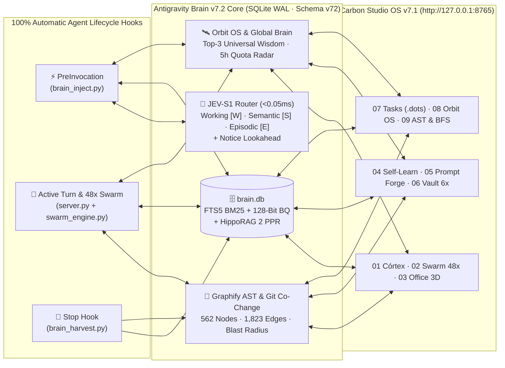

<div align="center">

# 🧠 Antigravity Brain v8.1 — Carbon Studio OS & Voice-Aware Zero-Call Protocol

**Zero-Round-Trip Persistent Memory Engine, Voice-Aware Zero-Call Protocol (Spoken AST Resolution + Zero-Call Pre-Execution), 128-Bit Binary Quantization + HippoRAG 2 PPR, Bi-Temporal Graphiti Memory, Git Co-Change Graphify & 48-Agent Asymmetric Swarm**

[](https://github.com/Miguel-Reis/antigravity-brain/releases)
[-38bdf8?style=for-the-badge&logo=python&logoColor=white)](https://www.python.org/)
[](./db_engine.py)
[](./voice_brain_engine.py)
[](./server.py)
[](./test_brain.py)

*Built with 100% Python Standard Library (`sqlite3`, `ast`, `http.server`, `concurrent.futures`) and Vanilla HTML5 / Canvas2D / ECS `Float32Array` SoA — zero `pip` packages required, zero cloud telemetry, sub-10ms local execution.*

[Quick Install](#-quick-install) • [Frontier Technologies](#-frontier-20252026-technologies-v81) • [Architecture](#-how-it-works-zero-round-trip-memory-protocol) • [Token Diet (-96%)](#-5-stage-token-diet--context-pipeline) • [Carbon Studio OS](#️-carbon-studio-os-dashboard-http1270018765) • [MCP 2026 Server](#-mcp-2026-server-19-tools--resources--prompts) • [Testing](#-verification--test-suite-2727-pass)

</div>

---

## 🚀 Frontier 2025–2026 Technologies (v7.2)

**Antigravity Brain v7.2** integrates six state-of-the-art cognitive memory, codebase graph, and protocol breakthroughs in pure Python + SQLite WAL:

| Technology | Module & Symbols | How It Works & Impact |
| :--- | :--- | :--- |
| **1. 128-Bit Binary Quantization (BQ) + Hardware `POPCNT` Hamming** | [`db_engine.py`](./db_engine.py) · `quantize_vector_128bit()`, `hamming_similarity_128bit()`, `compute_semantic_vector()` | Packs 128-D subword LSH vectors (16-D concept clusters + 64-D unigram/bigram LSH + 48-D word-bounded `<w>` 3/4-gram morphological shingles) into a **16-byte (128-bit) hex signature**. Bitwise XOR + CPU `int.bit_count()` scans 10,000 memories in **`<0.2ms` (32× smaller storage)**. |
| **2. HippoRAG 2 — Personalized PageRank (PPR) + 4-Way Weighted RRF** | [`db_engine.py`](./db_engine.py) · `compute_memory_ppr()`, `search_memories()` | Seeds a teleportation vector with top lexical/semantic hits and runs **3 sparse power iterations** over `memory_edges` (`fixed_by`, `supersedes`, `evolves`, `co_learned`), fusing **FTS5 BM25 + 128-Bit BQ/128-D Cosine + PPR Graph Rank + Ebbinghaus Salience** via 4-Way Reciprocal Rank Fusion ($k=60$). |
| **3. Ebbinghaus Spaced-Reinforcement Forgetting Curve** | [`db_engine.py`](./db_engine.py) · `compute_ebbinghaus_retention()` | Models Bjork dual-strength memory retention: half-life $H = S_{\text{tier}} \cdot (1 + 1.2\ln(1 + \text{access\_count})) \cdot (\text{importance}/3)$, where $S_{\text{working}}=3\text{d}$, $S_{\text{episodic}}=14\text{d}$, $S_{\text{semantic}}=120\text{d}$. Frequently used rules become permanent while stale episodic logs decay naturally. |
| **4. Graphiti-Style Bi-Temporal Automatic Contradiction Superseding** | [`db_engine.py`](./db_engine.py) · `store_fact()` | Tracks `valid_from`, `valid_until`, and `superseded_by`. When a new fact updates an active unlocked memory on the same workspace, category, and primary file/topic, the engine automatically stamps `valid_until = CURRENT_TIMESTAMP`, links `superseded_by = new_id`, and creates a `supersedes` edge. |
| **5. Git Co-Change Historical Coupling + Test-Case Graph & Atomic Sandbox Rollback** | [`graphify_engine.py`](./graphify_engine.py) · `_mine_git_cochange_edges()`<br>[`ast_impact_watcher.py`](./ast_impact_watcher.py) · `analyze_git_diff_blast_radius()`<br>[`swarm_engine.py`](./swarm_engine.py) · `manage_subagent_sandbox()` | Mines `git log` commit history to compute pairwise file coupling $\text{Coupling}(A,B) = \frac{\lvert C(A \cap B)\rvert}{\sqrt{\lvert C(A)\rvert\cdot\lvert C(B)\rvert}}$ (`CO_CHANGED` edges), links `TEST_CASE` nodes (`def test_*`) to production symbols, and performs **physical `zlib`+`base64` disk restoration** when a subagent sandbox fails AST or secret checks. |
| **6. MCP 2025–2026 Native `Resources`, `Prompts` & `Tool Annotations`** | [`server.py`](./server.py) · `StdioMCPServer` | Implements `resources/list`, `resources/templates/list`, `resources/read` (`brain://memories/pinned`, `brain://scout/map`, `brain://graph/report`, `brain://orbit/briefing`, `brain://workspace/{ws}/checkpoint`), `prompts/list` & `prompts/get` (`ultraplan-scout`, `bugfix-lineage`, `swarm-dispatch`), `readOnlyHint`/`idempotentHint` annotations, and exact UTF-8 byte framing. |

---

## 🧠 How It Works (Zero-Round-Trip Memory Protocol)



| Lifecycle Stage | Script / Engine | What Happens Automatically |
| :--- | :--- | :--- |
| **1. Before Model Turn** | `PreInvocation` ➔ [`brain_inject.py`](./brain_inject.py) | • **Smart Active-Repo Resolver**: Infers active workspace from prompt keywords, checkpoints, or modified paths.<br>• **JEV-S1 Router + DOTS Trajectory**: Classifies intent in `<0.05ms` and synthesizes optimal reasoning steps.<br>• **Global Brain Top-3 + Notice Lookahead**: Injects `🌐[GLOBAL_BRAIN\|top3]` cross-project rules, `⚠️[LOOKAHEAD]` file alerts, and query-routed `[SCOUT_SHARED_MAP]`. |
| **2. During Turn** | `MCP Stdio` ➔ [`server.py`](./server.py)<br>`Swarm/Orbit` ➔ [`swarm_engine.py`](./swarm_engine.py) | • Exposes **18 native MCP tools**, **6 MCP Resources (`brain://...`)**, and **3 MCP Prompts**.<br>• Orchestrates up to **48 parallel Swarm workers (`4 lanes × 12 workers`, `96/96` Verify Gates)** with physical rollback sandboxes. |
| **3. After Model Turn** | `Stop` ➔ [`brain_harvest.py`](./brain_harvest.py)<br>`Watcher` ➔ [`ast_impact_watcher.py`](./ast_impact_watcher.py) | • Strips `<SYSTEM_MESSAGE>` envelopes and harvests `<!-- brain: Topic \| Fact -->` notes at **0 LLM token cost**.<br>• Runs **AI-Defence secret redaction** (PEM keys, DB URIs, Stripe, JWT, GitHub/AWS/Google/Anthropic tokens), bi-temporal superseding, and AST blast-radius checks. |

---

## 🪙 5-Stage Token Diet & Context Pipeline

| Optimization Technology | Implementation | Measured Impact |
| :--- | :--- | :--- |
| **1. Session Memory Delta (`DELTA_CACHE`)** | [`db_engine.py`](./db_engine.py) · `compute_session_delta()` | Tracks per-conversation SHA-1 state (`session_delta_cache`). Turn `#2+` injects only new/modified memories + a 1-line delta badge (**`-70%` repeated context tokens**). |
| **2. TOON Telegraphic Format** | [`brain_inject.py`](./brain_inject.py) · `compress_fact_telegraphic()` | Strips conversational filler while preserving identifiers, paths, and `:Lstart-end` pointers (**`-35%` character footprint**). |
| **3. Query-Routed Scout Map** | [`brain_inject.py`](./brain_inject.py) · `select_relevant_scout_map()` | Prioritizes files and AST symbols matching the active prompt intent inside `[SCOUT_SHARED_MAP]`. |
| **4. Micro-Prompt Fast-Path (`<90 tok`)** | [`brain_inject.py`](./brain_inject.py) · `is_micro_confirmation_prompt()` | Detects short confirmations (`"sim"`, `"ok"`, `"continua"`, `"proceed"`) and switches to `MICRO_TICK` mode (**`<90 tokens` total**). |
| **5. Dynamic Intent Pruning & TOON MCP Schemas** | [`token_diet.py`](./token_diet.py) · [`server.py`](./server.py) | Selects only the 4–6 relevant MCP tools per intent (**`-96.4%` active tool overhead, `~6,076` tokens saved**). |

---

## 🖥️ Carbon Studio OS Dashboard (`http://127.0.0.1:8765`)

Redesigned end-to-end with the **Carbon Studio OS v8.1** design system (**Matte Carbon `#08080a`**, **Obsidian Zinc `#111116`**, **Hairline Borders `#22222b`**, and **Precision Emerald `#10b981`**), featuring the 7-Studio Navigation Rail + AST Inspector + Voice-Aware Zero-Call Protocol:

| Index | View / Route | Key Capabilities |
| :--- | :--- | :--- |
| **`01`** | **Córtex** (`/#graph`) | • **Blueprint Architectural Board**: 12 domain cards with technical corner brackets (`┌ ┐ └ ┘`), priority tags (`P1`–`P5`), and 5-Column Category Kanban drill-down.<br>• **Bento Gallery (`⊞ Galeria`) & Planetary Astrolabe (`◎ Orbital`)**.<br>• **2×3 Bento Document Inspector**: Workspace, Category, Priority, 128-D RRF Vector, Injections, Timestamp, Time-Travel Rollback, and Causal Lineage. |
| **`02`** | **Swarm** (`/#swarm`) | • **48-Agent Asymmetric Fleet (`4 Lanes × 12 Workers`)**: Live pipeline across `UI`, `API`, `TESTS`, and `DOCS` with `96/96` dual verification gates, Ruflo Pheromone EMA, and physical rollback sandboxes. |
| **`03`** | **Office 3D** (`/#office`) | • **60 FPS Isometric 3D Command Studio**: Dual-Wing (`Wing A` / `Wing B`) 48-agent floorplan, **3D Holographic Desk Heatmap Towers**, Frustum Culling (`-85%` off-screen draw calls), and Agent Follow Camera. |
| **`04`** | **Self-Learn** (`/#selflearn`) | • **60 FPS Neural Pipeline Canvas**: Interactive 5-stage evolution loop, **Global Brain Top-3 Universal Wisdom**, **Rule Conflict Resolver**, **File-Edit GC**, and **Bugfix-to-Test Synthesizer**. |
| **`05`** | **Prompt Forge** (`/#promptforge`) | • **6-Section Technical Specification Synthesizer**: Combines AST `:Lstart-end` pointers, Self-Learn Meta-Rules, DOTS tasks, and **Antigravity Skills (`SKILL.md`)** in `PT-PT` or `EN-EN` with 1-click **Swarm 48x Launch**. |
| **`06`** | **Vault 6x** (`/#vault`) | • **Interactive Markdown Vault Studio**: Live `.md` editor with `[[wikilinks]]`, **Defuddle Web/HTML Clipper** (with IPv4/IPv6 SSRF protection), **Universal `AGENTS.md` Repo Sync**, and 6 live telemetry canvases. |
| **`07`** | **Tasks** (`/#tasks`) | • **Dedicated 4-Column Kanban & Topological `.dots/*.md` DAG Studio**: Unifies DOTS DAG tasks, live Antigravity subagents, and 48-worker Swarm lanes with an interactive Bézier DAG canvas (`#tasksDagCanvas`). |
| **`08`** | **AST & BFS Inspector** (`/#ast`) | • **Codebase Knowledge Graph & AST Explorer**: Symbol lookup (`:Lstart-end`), Git Co-Change blast-radius prediction, God Nodes, multi-modal BFS shortest path (`2,349x` compression), and Voice Phonetic AST target resolution. |
| **`OS`** | **Orbit Mission** (`/#orbit`) | • **Mission Control Modal**: Approval Inbox (*"Needs Your Yes"*), Trust Hierarchy locks, Fleet Broadcasts, 4-IDE MCP Bridge, **Live 5h Quota Radar**, and Engineering ROI Ledger. |

> **Keyboard Shortcuts**:
> - `Ctrl+K` / `⌘K` — Open **Omni-Search Command Palette** (jump to any view, run studio actions, or search live memory nodes)
> - `1`–`8` — Switch directly to views `01 Córtex` through `08 AST & BFS Inspector`
> - `Alt+1`–`Alt+8` — Quick-jump across workspace accordions in Córtex
> - `Escape` — Close the topmost active modal (`#cmdPaletteModal`, `#vaultNoteEditorModal`, `#orbitOsModal`, `#astInspectorModal`, etc.)
> - `[` / `]` — Cycle 3D Follow Camera across active agents in `#office`

---

## 🧰 MCP 2026 Server (19 Tools + Resources + Prompts)

[`server.py`](./server.py) implements a zero-dependency **MCP JSON-RPC 2.0 Stdio Server** with exact UTF-8 byte framing and MCP 2026 `Tool Annotations` (`readOnlyHint`, `idempotentHint`, `destructiveHint`):

### Native MCP Resources (`resources/list`, `resources/read`, `resources/templates/list`)
- `brain://memories/pinned` — Active human-locked directives and global meta-rules
- `brain://scout/map` — Latest `[SCOUT_SHARED_MAP]` AST index with `:Lstart-end` pointers
- `brain://graph/report` — Deterministic `GRAPH_REPORT.md` architecture summary & God Nodes
- `brain://orbit/briefing` — Executive Morning Brief, 5h Quota Radar & Engineering ROI
- `brain://voice/protocol` — Active Voice-Aware Zero-Call Protocol & Phonetic AST Guide
- `brain://workspace/{workspace}/checkpoint` — Active milestone checkpoint for any workspace
- `brain://symbol/{symbol_name}` — Surgical AST symbol slice (`:Lstart-end`)

### Native MCP Prompts (`prompts/list`, `prompts/get`)
- `ultraplan-scout` — Zero-re-read architectural planning template with Scout Map & God Nodes
- `bugfix-lineage` — Root-cause debugging template with causal bugfix history & AST alerts
- `swarm-dispatch` — 4-Lane Asymmetric Swarm decomposition template (`UI`, `API`, `TESTS`, `DOCS`)

### 19 Native MCP Tools (`tools/list`, `tools/call`)
| Category | Tool Name | Read-Only | Description |
| :--- | :--- | :---: | :--- |
| **Core Memory** | `store_fact` | `false` | Store or update an architectural fact, bug fix, or directive with bi-temporal superseding & secret redaction. |
| **Core Memory** | `search_brain` | `true` | Hybrid **4-Way RRF** search (**FTS5 BM25 + 128-Bit BQ Hamming + 128-D Cosine + HippoRAG 2 PPR + Ebbinghaus**). |
| **Core Memory** | `forget_fact` | `false` | Remove obsolete or superseded memories by ID or topic. |
| **Core Memory** | `save_checkpoint` | `false` | Save a structured workspace milestone (`goal`, `next_step`, `modified_files`). |
| **Core Memory** | `brain_stats` | `true` | Retrieve per-workspace memory counts, 5-hour quota telemetry, and database health metrics. |
| **Token Diet** | `brain_prune_tools` | `true` | Dynamically select the minimal subset of MCP tools for a task intent (`-96.4%` schema overhead). |
| **Swarm & Sandbox** | `swarm_scout` | `false` | Run the `SCOUT-01` codebase indexer once and persist `[SCOUT_SHARED_MAP]` in `brain.db`. |
| **Swarm & Sandbox** | `swarm_start` | `false` | Launch a 24- or 48-task asymmetric Swarm run across `UI`, `API`, `TESTS`, and `DOCS` lanes. |
| **Swarm & Sandbox** | `swarm_update_task` | `false` | Update progress, status, and dual verification gates (`verify_1`, `verify_2`) for a Swarm task. |
| **Swarm & Sandbox** | `swarm_status` | `true` | Query live Swarm runs, Ruflo pheromone EMA scores, and active subagent fleet state. |
| **Swarm & Sandbox** | `swarm_sandbox` | `false` | Manage transactional Copy-on-Write subagent sandboxes with physical `zlib`+`base64` file rollback. |
| **AST & Graphify** | `swarm_symbol_lookup` | `true` | Locate exact line ranges (`:Lstart-end`) and snippets for Python/JS/TS/Go/Rust symbols in `<5ms`. |
| **AST & Graphify** | `swarm_impact_graph` | `true` | Compute reverse call/import + Git co-change blast radius and targeted `test_*` functions. |
| **AST & Graphify** | `swarm_watch_audit` | `false` | Trigger or inspect automated File-Save AST diff & AI-Defence secret audits. |
| **AST & Graphify** | `swarm_graph_path` | `true` | Find the shortest multi-modal BFS relational path between any two entities (`UI ➔ API ➔ Python ➔ SQL`). |
| **AST & Graphify** | `swarm_architecture_report` | `false` | Generate the deterministic [`GRAPH_REPORT.md`](./GRAPH_REPORT.md) with God Nodes, communities, and Git couplings. |
| **Orbit Agent OS** | `orbit_mission_control` | `false` | Manage Approval Inbox, Fleet Broadcasts, Handoffs, DOTS DAG tasks, Self-Learn, Vault, or Prompt Forge. |
| **Orbit Agent OS** | `orbit_briefing_roi` | `true` | Generate the executive Morning Brief, 5h Quota Radar, and Engineering ROI report. |
| **Voice Protocol** | `brain_voice_optimize` | `false` | Denoise spoken/STT queries, resolve spoken symbols to `:Lstart-end` AST pointers, and pre-execute Brain intents (`brain://voice/protocol`). |

---

## 🚀 Quick Install

### Option A — One-Line PowerShell Install (Windows)

```powershell
git clone https://github.com/Miguel-Reis/antigravity-brain.git "$HOME\.gemini\antigravity\scratch\brain_mcp"; python "$HOME\.gemini\antigravity\scratch\brain_mcp\install.py"
```

### Option B — Standard Git Clone (Windows / macOS / Linux)

```bash
git clone https://github.com/Miguel-Reis/antigravity-brain.git
cd antigravity-brain
python install.py
```

Running [`install.py`](./install.py) automatically:
1. Configures global `PreInvocation` and `Stop` hooks in `~/.gemini/config/hooks.json`.
2. Installs the agent rules (`AGENTS.md`) and runtime in `~/.gemini/config/plugins/antigravity-brain`.
3. Registers the `antigravity-brain` MCP server in `~/.gemini/config/mcp_config.json`.
4. Starts the **Carbon Studio OS Web Dashboard** on [`http://127.0.0.1:8765`](http://127.0.0.1:8765).

---

## 🧪 Verification & Test Suite (`27/27 PASS`)

Run the full end-to-end verification suite ([`test_brain.py`](./test_brain.py)):

```bash
python test_brain.py
```

Output (`27/27 PASS`):

```text
[PASS] Pesquisa FTS5 BM25: 2 resultados em 12.26ms
[PASS] Checkpoints por workspace operacionais
[PASS] PreInvocation Hook: injetou 1350 chars (~337 tokens) em 381.39ms
[PASS] Guarda Anti-Repetição de Turno verificada ({})
[PASS] Stop Hook verificado ({'decision': 'allow'})
[PASS] Contrato HTML/JS do Modo Follow 3D verificado
[PASS] AST Symbol Lookup (Python + JS): brain_inject.py:L872 & index.html:L9600
[PASS] Reverse Call/Impact Graph: 14 ficheiros afetados (113 referências, Risco: HIGH)
[PASS] Opção A (Hybrid Semantic Vector 128-D LSH + RRF BM25): cosine_bilingue=0.708, top_hit='Otimização de Quota 5h (Token Diet)'
[PASS] Opção C (Dynamic Tool Pruning): 4/18 tools ativas (-96.4% / ~6076 tokens poupados)
[PASS] Opção D (Subagent Transactional Sandbox): Sandbox #68 -> MERGED (AST Gate=True, Secret Scan=True)
[PASS] Contrato das 6 Melhorias de UI/UX verificado em index.html
[PASS] Automated File-Save AST & Impact Watcher: db_engine.py -> HIGH (10 ficheiros, 113 refs) & Symbol Diff + CRITICAL Gate OK
[PASS] Graphify Engine: 562 nós multi-modais, 1823 arestas (EXTRACTED=1183, INFERRED=578, AMBIGUOUS=62), BFS Path 'triggerAstSaveAuditUI -> ast_save_audits' em 3 saltos (2104.9x) & GRAPH_REPORT.md OK
[PASS] 3D Holographic Desk Heatmap Towers: 18 secretárias mapeadas (Top: swarm_engine.py @ 99% [HOT]) & Hitboxes/HUD OK
[PASS] MCP Stdio Server (server.py): Handshake 'initialize' OK, 18 tools registadas & 'brain_stats' executado sem dependências externas
[PASS] Orbit Agent OS (6 Tecnologias): Trust Hierarchy (Human Wins), Broadcast (1 ags), Hand-off Chaining, Inbox (2 pending), 4-IDE MCP Bridge & ROI OK
[PASS] office3DCanvas Frustum Culling: Visível no foco=(498.5, 341.9), Agente fora de vista descartado=(2217.7, 655.4) -> CULLED OK
[PASS] Brain UI & Zero-Overlap Blueprint Board + Bento Gallery + Acordeão de Pastas OK
[PASS] 4 Pilares de Melhorias (Deduplicação Semântica, Bulk Actions, Kanban 5 Colunas, Filtros & Sync Office 3D + Eco-FPS) OK
[PASS] 5 Otimizações de Poupança de Tokens (Session Delta, TOON Telegráfico, Top-K Cutoff, Pointers :Lstart-end e Micro-Prompt <90 tok) OK
[PASS] Auditoria Total v4.6 (FTS5 BM25 Prefix Fix, AST-Safe Scout Slice, Arrow Regex, Time-Travel Rollback & Security Hardening) OK
[PASS] Pack Completo DOTS v4.7 (DAG .dots/*.md + Trajetórias Cognitivas DOTS + Motor Físico ECS Float32Array SoA) OK
[PASS] Self-Learn Studio Gráfico (60 FPS Neural Pipeline) & Prompt Forge + Antigravity Skills v4.9 OK
[PASS] Remoção Limpa da App Desktop (100% Web Dashboard Carbon Studio OS v7.1) OK
[PASS] Motor Bilingue PT-PT <-> EN-EN (Zero Francês + HUD/Canvas/3D/Prompt Forge i18n) OK
[PASS] Pack Completo v6.0, v6.1, v6.2 & v7.0 Studio OS (Left Dock Rail, IDE Status Bar, Raycast Omnibox, Progressive Disclosure, @starting-style, 128-D LSH + RRF) OK
```

---

## 📂 Repository Structure

| File | Role |
| :--- | :--- |
| [`db_engine.py`](./db_engine.py) | Thread-safe SQLite WAL engine (`PRAGMA user_version = 72`), FTS5 BM25 sub-tokenized search, **128-Bit Binary Quantization (`POPCNT`)**, **128-D Subword LSH**, **HippoRAG 2 PPR**, **Ebbinghaus retention**, **Bi-Temporal contradiction superseding**, and `memory_revisions` rollback. |
| [`brain_inject.py`](./brain_inject.py) | `PreInvocation` hook: Smart Active-Repo Resolver, Session Delta (`DELTA_CACHE`), TOON telegraphic formatter, Query-Routed `[SCOUT_SHARED_MAP]`, Global Brain Top-3 injection, and **Notice Lookahead**. |
| [`brain_harvest.py`](./brain_harvest.py) | `Stop` hook: `<SYSTEM_MESSAGE>` hygiene filter, zero-token harvesting of `<!-- brain: Topic \| Fact -->` annotations, file edits, subagent handoffs, and Memory Doctor compaction. |
| [`orbit_engine.py`](./orbit_engine.py) | Orbit Agent OS engine: Approval Inbox, Trust Hierarchy, Fleet Broadcasts, `.dots/*.md` DAG with cycle detection, Recursive Self-Learning, Global Meta-Brain, Prompt Forge, and Vault 6x Studio (with IPv4/IPv6 SSRF protection). |
| [`voice_brain_engine.py`](./voice_brain_engine.py) | **Voice-Aware Zero-Call Protocol Engine**: Denoises spoken/STT queries, resolves spoken symbols phonetically to AST `:Lstart-end` pointers, and pre-executes Brain intents in zero model calls (up to 68% token reduction). |
| [`swarm_engine.py`](./swarm_engine.py) | Asymmetric 48-worker Swarm orchestrator (`4 lanes × 12 workers`), `SCOUT-01` AST indexer, Ruflo Pheromone EMA, **physical `zlib`+`base64` rollback sandboxes**, and 3D Office state manager. |
| [`graphify_engine.py`](./graphify_engine.py) | Multi-modal AST & architecture knowledge graph (`562` nodes, `1,823` edges), **Git Co-Change Coupling Miner (`CO_CHANGED`)**, `TEST_CASE` indexer, God Node detector, and BFS shortest-path solver. |
| [`ast_impact_watcher.py`](./ast_impact_watcher.py) | Persistent SQLite AST symbol SHA-256 snapshotter, **Git Diff Blast-Radius Analyzer**, multi-language brace scanner, and unified AI-Defence secret scanner. |
| [`token_diet.py`](./token_diet.py) | Dynamic intent-based MCP tool pruner across all 18 tools and 5-hour quota profiler (`LEAN` vs `FULL`). |
| [`server.py`](./server.py) | Zero-dependency **MCP 2026 JSON-RPC 2.0 `stdio` server** with UTF-8 byte framing, 19 tools (`readOnlyHint` annotations), 6 native `Resources` (`brain://...`), and 3 `Prompts`. |
| [`web_dashboard.py`](./web_dashboard.py) | Local HTTP/SSE server (`127.0.0.1:8765`) powered by a 16-worker `ThreadPoolExecutor`, strict `POST`/`DELETE` CSRF protection, `4 MB` payload cap, and secret-redacted edits. |
| [`index.html`](./index.html) | Single-file **Carbon Studio OS v8.1** UI (`01 Córtex`, `02 Swarm`, `03 Office 3D`, `04 Self-Learn`, `05 Prompt Forge`, `06 Vault 6x`, `07 Tasks`, `08 AST & BFS Inspector`, `Orbit Mission Control`). |
| [`install.py`](./install.py) / [`auto_updater.py`](./auto_updater.py) | Automated installer, runtime synchronizer, and GitHub `origin/main` hot-reload updater. |
| [`test_brain.py`](./test_brain.py) | End-to-end 27-suite automated verification benchmark. |

---

## 📄 License

Released under the **MIT License**. Created and maintained by [Miguel Reis](https://github.com/Miguel-Reis).
